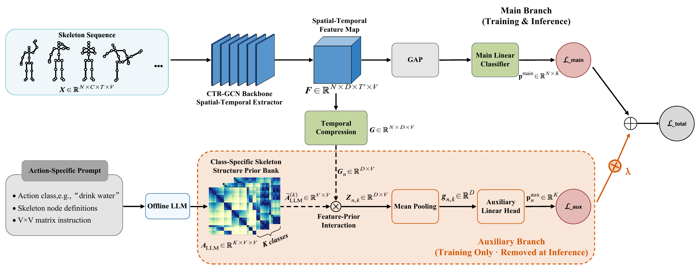

# SkePri

PyTorch implementation of **Language-Derived Class-Specific Structural Prior Learning for Skeleton-Based Action Recognition**.

SkePri introduces fixed, language-derived class-specific structural priors into CTR-GCN through a training-only auxiliary branch. The auxiliary branch and prior bank are removed during inference, preserving the original prediction pathway and introducing no additional inference cost.

## Architecture of SkePri



## Prerequisites

Original experiment environment, confirmed on the authors' server:

- Python 3.7.11
- PyTorch 1.11.0
- CUDA 11.3
- NumPy 1.20.3
- PyYAML 6.0
- tqdm 4.65.0
- NVIDIA GeForce RTX 4090

Keep your existing PyTorch/CUDA installation (PyTorch 1.11.0 or newer). Install PyTorch separately if it is absent, then install the core dependencies:

```bash
git clone https://github.com/YangZust/SkePri.git
cd SkePri
python -m pip install -r requirements.txt
```

The requirements file does not install or upgrade PyTorch/CUDA. Core training and inference require neither OpenAI SDK nor network access once local inputs are available. The optional prior-generation SDK is installed separately; see [Prior Banks](priors/README.md).

The engineering smoke tests passed with Python 3.7.11 / PyTorch 1.11.0+cpu / NumPy 1.20.3 and Python 3.9.24 / PyTorch 2.7.1 / NumPy 2.0.2. These test environments are distinct from the original CUDA 11.3 / RTX 4090 environment. See [Reproducibility](REPRODUCIBILITY.md) for test scope and limitations.

## Data Preparation

### Download Datasets

SkePri is evaluated on three skeleton-based action recognition datasets:

- **NTU RGB+D 60 and NTU RGB+D 120:** [official dataset page](https://rose1.ntu.edu.sg/dataset/actionRecognition).
- **NW-UCLA:** obtain the skeleton sequences from the dataset authors or the archive linked in the [CTR-GCN repository](https://github.com/Uason-Chen/CTR-GCN).

For NTU RGB+D, the preprocessed annotations provided by PYSKL can also be used directly:

- [NTU RGB+D 60 annotations](https://download.openmmlab.com/mmaction/pyskl/data/nturgbd/ntu60_3danno.pkl)
- [NTU RGB+D 120 annotations](https://download.openmmlab.com/mmaction/pyskl/data/nturgbd/ntu120_3danno.pkl)

### Data Processing

For raw NTU skeleton data, place the extracted `.skeleton` files in `data/NTU60/` or `data/NTU120/`. NTU120 requires the files from both the original and extension datasets. Run:

```bash
python data/prepare_ntu.py --dataset ntu60 --raw-dir data/NTU60
python data/prepare_ntu.py --dataset ntu120 --raw-dir data/NTU120
```

Place the generated or downloaded annotations and NW-UCLA sequences in the following locations:

```text
data/
├── nturgbd/
│   ├── ntu60_3danno.pkl
│   └── ntu120_3danno.pkl
└── NW-UCLA/
    └── all_sqe/
        └── *.json
```

NW-UCLA is processed by the data feeder. See [Data Preparation](data/README.md) for detailed download, preprocessing, and split instructions.

## Training & Testing

### Training

Choose the YAML file corresponding to the desired dataset, evaluation protocol, and input stream. For example, to train SkePri on NTU RGB+D 60 X-Sub with the joint modality on GPU 0:

```bash
python main.py --config config/ntu60-xsub/joint.yaml --device cuda:0 --validate --test-best
```

The configuration directories are:

| Dataset | Protocol | Configuration directory |
| --- | --- | --- |
| NTU RGB+D 60 | X-Sub | `config/ntu60-xsub/` |
| NTU RGB+D 60 | X-View | `config/ntu60-xview/` |
| NTU RGB+D 120 | X-Sub | `config/ntu120-xsub/` |
| NTU RGB+D 120 | X-Set | `config/ntu120-xset/` |
| NW-UCLA | Cross-View | `config/nwucla/` |

Each directory provides `joint.yaml`, `bone.yaml`, `joint_motion.yaml`, and `bone_motion.yaml`. All configurations use an auxiliary loss weight of 0.01 and five repetitions of the training set per epoch. Training runs for 90 epochs on NTU and 65 epochs on NW-UCLA. The official test split is used for checkpoint selection; NTU uses single-clip selection and ten-clip final evaluation. NW-UCLA uses single-clip evaluation.

Fixed structural prior banks are included in [`priors/`](priors/README.md). Training and inference do not require an LLM or API key. Optional offline generation instructions are provided in the prior documentation.

Training saves the best checkpoint and final prediction scores under the configured `work_dirs/` directory. Use `--work-dir` to specify a new directory for another run.

### Testing

Evaluate a trained model using its inference checkpoint:

```bash
python main.py --config config/ntu60-xsub/joint.yaml --phase test --weights work_dirs/ntu60-xsub/joint/best_inference.pth --trust-checkpoint --device cuda:0 --output work_dirs/ntu60-xsub/joint/test_scores.npz
```

The inference checkpoint excludes the auxiliary branch and structural prior bank. On older PyTorch versions without `weights_only`, use `--trust-checkpoint` only for weights you created or obtained from a trusted source. The same flag is required for `--init-weights` on those versions. Newer PyTorch always uses `weights_only=True`, even when the flag is present, and never falls back to unrestricted loading.

### Four-stream Ensemble

Train the four modalities under the same evaluation protocol and combine their saved prediction scores:

```bash
python ensemble.py \
  --joint work_dirs/ntu60-xsub/joint/best_scores.npz \
  --bone work_dirs/ntu60-xsub/bone/best_scores.npz \
  --joint-motion work_dirs/ntu60-xsub/joint_motion/best_scores.npz \
  --bone-motion work_dirs/ntu60-xsub/bone_motion/best_scores.npz \
  --weights 1 1 1 1
```

The example uses equal weights in J/B/JM/BM order. It does not specify the manuscript's historical fusion weights.

For the current implementation's benchmark verification status, see [Reproducibility](REPRODUCIBILITY.md).

## Acknowledgements

This implementation builds on [CTR-GCN](https://github.com/Uason-Chen/CTR-GCN) and [PYSKL](https://github.com/kennymckormick/pyskl). We thank the original authors for their work.

## License

See [LICENSE](LICENSE) and [upstream licenses](licenses/) for the applicable terms and attribution.
